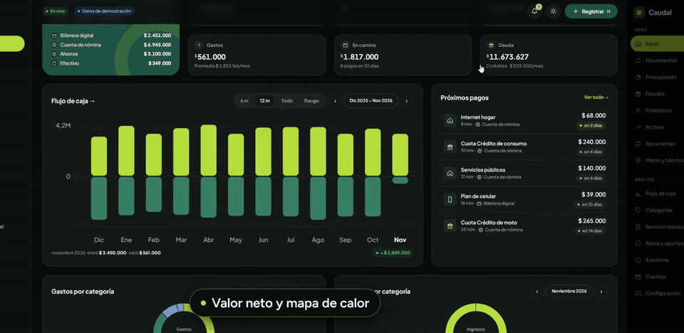
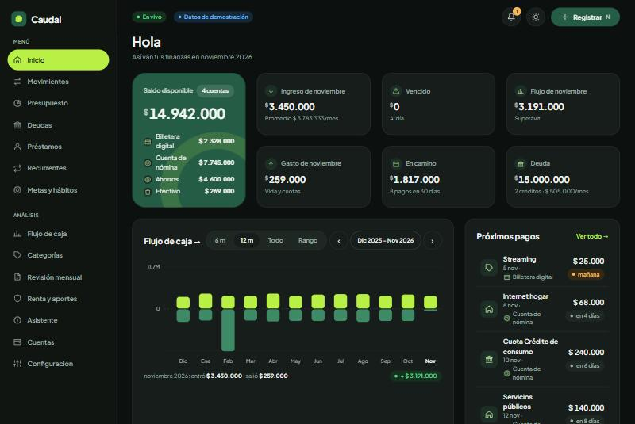
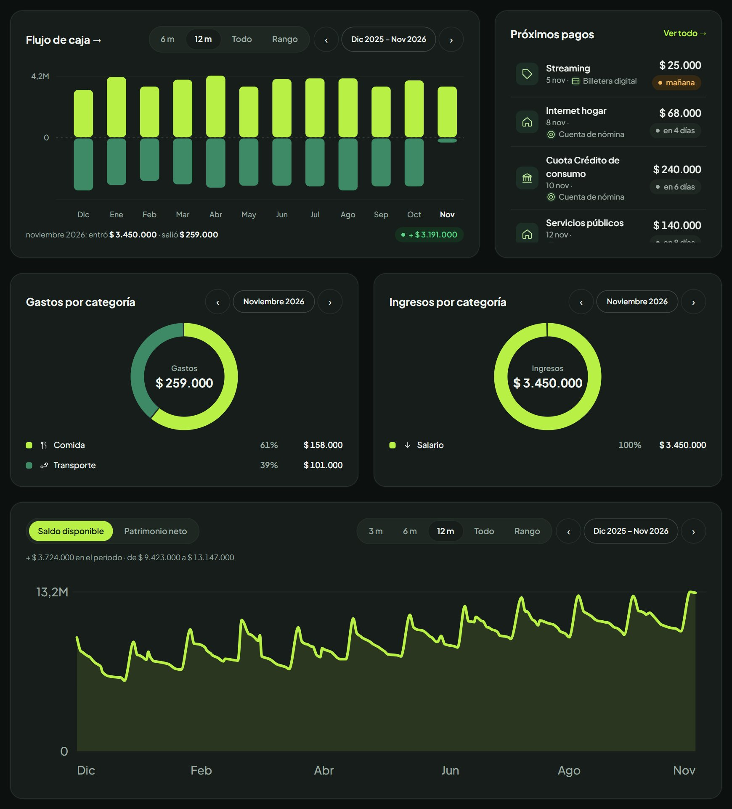
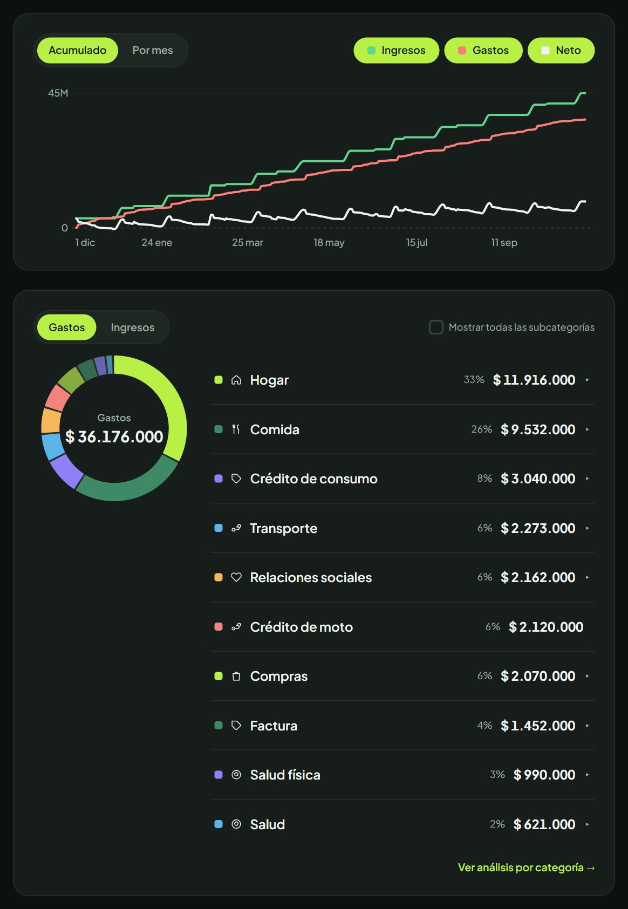
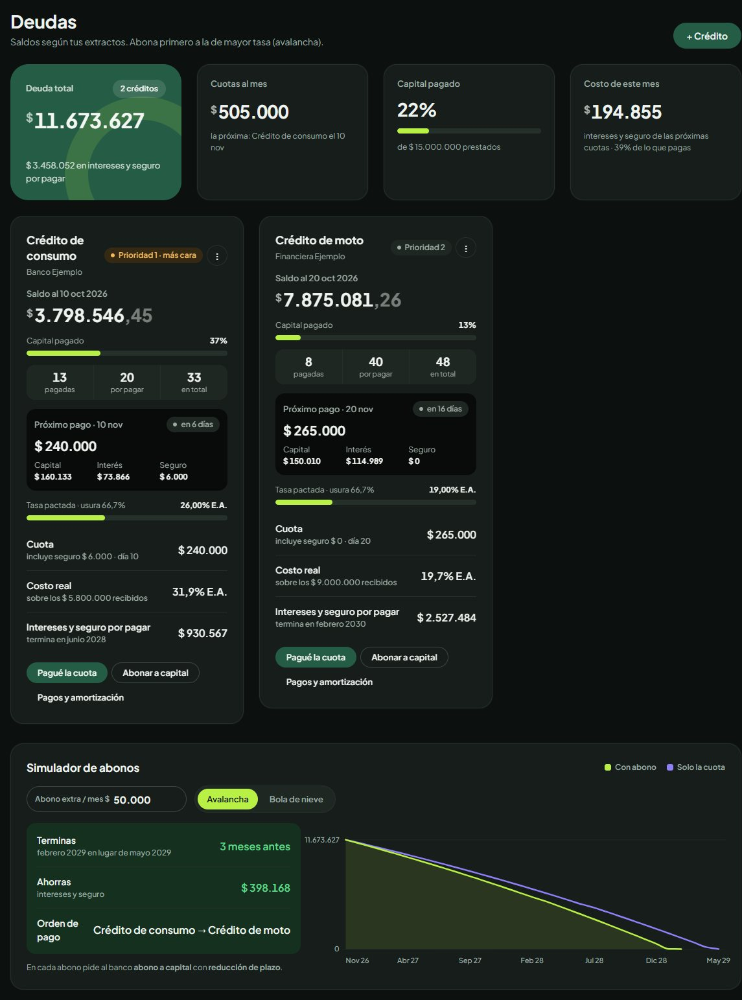
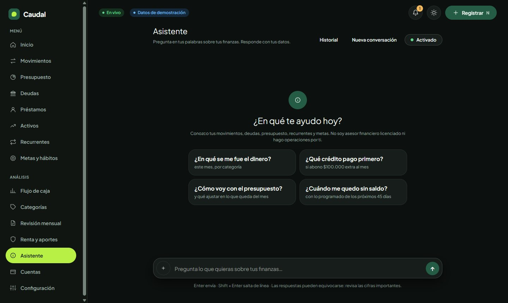
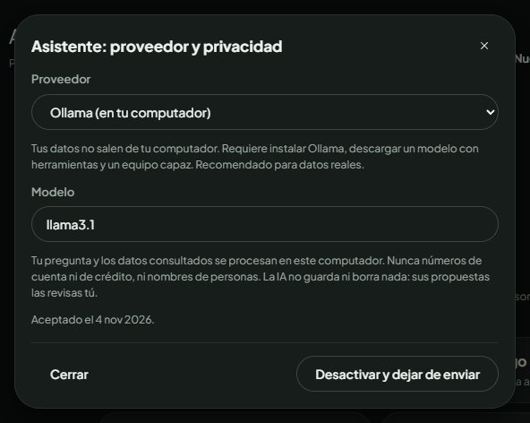
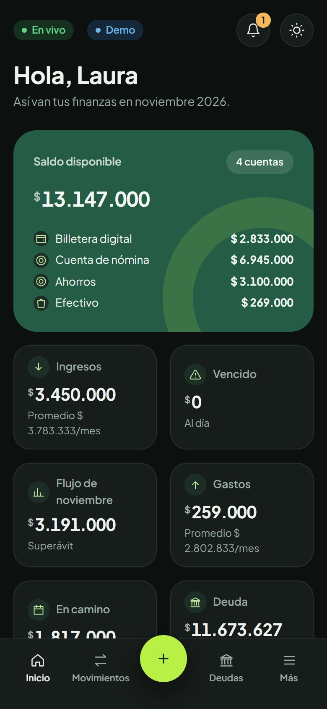
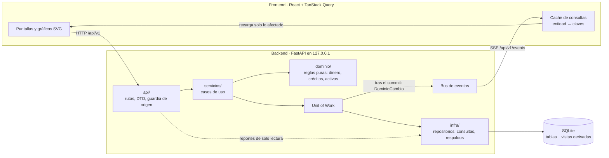

# Caudal · Finanzas

[English](README.md) · **Español**

Caudal es una app de finanzas personales para Colombia que funciona en tu computador. Lleva cuentas, presupuestos,
deudas, activos e impuestos, y recalcula todo en vivo cada vez que registras un movimiento. Tus datos se quedan en tu
equipo, en un archivo SQLite.

> Las capturas y la demo usan datos **ficticios**: una persona inventada, generada con semilla fija.



https://github.com/user-attachments/assets/19c2f237-1216-46fd-a10f-8276519e8d2f



| Gráficas de Inicio | Gráficas de flujo de caja |
|---|---|
|  |  |

| Deudas | Asistente |
|---|---|
|  |   |



## El problema

La mayoría de las apps de finanzas suponen un salario fijo y un banco que se sincroniza. Eso deja por fuera a quien
tiene ingresos irregulares, créditos de consumo caros y pagos en efectivo o billetera. Esa persona necesita saber tres
cosas en cualquier momento: cuánto tiene disponible de verdad, qué se vence pronto y qué deuda pagar primero. Y no
debería entregar su historial financiero a un tercero para saberlo.

Caudal responde esas preguntas con datos que registras en segundos, y los guarda todos en tu computador.

## Qué hace

- **Captura rápida** de gastos, ingresos y transferencias, con sugerencia de categoría y actualización en vivo.
- **Inicio y flujo de caja**: Ingresos y Gastos con todo incluido, vencidos, próximos pagos, donas y mapa de calor.
- **Patrimonio neto**: cuentas, lo que te deben y activos, menos créditos y préstamos.
- **Activos e inversiones**: CDT, fondos, acciones, cripto, cesantías, inmuebles y vehículos, con valor, ganancia y
  rentabilidad. Aportar o vender no cuenta como gasto ni como ingreso.
- **Deudas**: amortización con extractos, costo real frente a la tasa de usura y simulador avalancha o bola de nieve.
- **Presupuesto** por grupos de categorías, **recurrentes** con calendario y saldo proyectado, y **metas**.
- **Préstamos con personas**, con alerta de costo tipo gota a gota.
- **Renta y aportes**: termómetro en UVT con tus activos, seguridad social e ingresos en USD con la TRM oficial.
- **Tus datos**: exporta en JSON, SQLite o Excel; carga con vista previa, restaura respaldos o borra todo.
- **Asistente opcional** con tu propia clave: Gemini, Groq, OpenRouter, Claude u Ollama en tu computador. Solo propone
  borradores; tú revisas y confirmas.
- **PWA instalable** y respaldos diarios.

## Arquitectura



Las dependencias apuntan hacia adentro: `api → servicios → dominio`, e `infra` implementa lo que el dominio necesita.
Una escritura pasa por un solo caso de uso, dentro de un Unit of Work. Solo cuando el commit sale bien, el Unit of Work
publica un evento `DominioCambio` con las entidades que tocó. Todos los clientes abiertos lo reciben por Server-Sent
Events e invalidan solo las consultas afectadas. Por eso un gasto registrado en el celular actualiza el tablero del
computador sin recargar.

## Decisiones clave

Los registros completos están en [`docs/sistema/adr/`](docs/sistema/adr/) y el esquema en
[`docs/sistema/03_MODELO_DATOS.sql`](docs/sistema/03_MODELO_DATOS.sql).

- **El dinero es un entero en centavos.** Los decimales flotantes acumulan error, y las sumas deben cuadrar al peso.
  Los montos llevan signo: positivo entra, negativo sale. El formato se aplica solo al mostrar.
- **Los valores derivados no se guardan.** Saldos y totales mensuales salen de vistas SQL y consultas de lectura, así
  que no pueden desincronizarse de los movimientos. Un saldo se corrige con un movimiento de ajuste; nunca se edita.
- **Recálculo automático por eventos, no por sondeo.** Se eligieron eventos de dominio tras el commit más SSE, frente a
  WebSockets (no hace falta tráfico en dos sentidos), sondeo (gasta recursos y tiene retraso) y triggers SQL (frágiles
  y difíciles de probar).
- **Local y de un solo usuario.** La API solo escucha en `127.0.0.1` y rechaza escrituras de otros orígenes y hosts. La
  única llamada externa por defecto es la TRM en datos.gov.co.
- **El asistente lee agregados y propone, nunca escribe.** Sus herramientas de «escritura» generan un borrador que abre
  el formulario de siempre. Las claves viven fuera de la base, así que no viajan en exportaciones ni respaldos.
- **Ingresos y Gastos incluyen todo.** Se usa un solo par de totales en todas las pantallas, e Ingresos − Gastos
  siempre es igual al flujo operativo.

## Tecnologías

| Capa | Tecnología |
|---|---|
| Backend | Python 3.12+, FastAPI, SQLAlchemy 2, Alembic, SQLite |
| Frontend | React 19, TypeScript, Vite, TanStack Query y Router, gráficos SVG propios |
| Calidad | pytest, Hypothesis, ruff, mypy, Vitest, Testing Library, ESLint |
| CI | GitHub Actions: backend, frontend y gitleaks |

## Probarla

Requisitos: [uv](https://docs.astral.sh/uv/) y Node 22 o superior.

```bash
git clone https://github.com/juandmurillo/finanzas-co.git
cd finanzas-co/app/backend
uv sync
uv run finanzas migrar
uv run finanzas sembrar
uv run finanzas servir        # API en http://127.0.0.1:8000
```

En otra terminal:

```bash
cd finanzas-co/app/frontend
npm install
npm run dev                   # http://localhost:5173
```

La primera vez eliges entre **empezar con tus datos** o **explorar con datos de ejemplo** (también con
`uv run finanzas demo`). Después de instalar, `iniciar.bat` (Windows) o `./iniciar.sh` (macOS y Linux) levantan las dos
partes. Si tu red intercepta TLS, usa `uv --system-certs` y `NODE_OPTIONS=--use-system-ca`.

## Pruebas

- **Backend: 140 pruebas** (pytest). Cubren reglas de dominio, flujos de la API contra una base temporal, migraciones,
  exportar y volver a cargar, archivos dañados que se rechazan y el asistente con un transporte HTTP falso.
- **Frontend: 37 pruebas** (Vitest). Incluyen una prueba de humo que monta las 15 rutas con datos demo.
- Todas usan datos ficticios y ninguna llama a una API de pago.

```bash
cd app/backend && uv run pytest -q && uv run ruff check src tests && uv run mypy src
cd app/frontend && npm run typecheck && npm run lint && npm test
```

## Privacidad y seguridad

- El asistente está apagado hasta que aceptas, y cambiar de proveedor pide aceptar de nuevo. Con Ollama, nada sale de
  tu computador.
- Un archivo cargado se valida en una base temporal antes de tocar tus datos, y antes de reemplazarlos se hace un
  respaldo.
- `data/` y `.env` están fuera del repositorio, y CI corre gitleaks.
- Sin PIN por ahora: si la abres en tu red local, hazlo solo en una Wi-Fi de confianza.

No es asesoría financiera, tributaria ni legal. Verifica los valores vigentes (UVT, usura, TRM) antes de usarlos.

## Limitaciones y hoja de ruta

**Limitaciones de hoy**

- Un solo usuario, sin inicio de sesión ni PIN, y sin versión alojada.
- Solo Colombia: moneda, topes de renta y reglas de crédito. La interfaz está solo en español.
- Sin sincronización bancaria. Los datos entran a mano o con un CSV exportado de Cashew.
- En el celular funciona como PWA servida desde tu computador por la red local, no como app independiente.
- La conversación del asistente no se guarda entre sesiones, y los niveles gratis de los modelos cambian sin aviso.
- El patrimonio histórico es aproximado antes de que un crédito se registrara en la app.

**Hoja de ruta**

- App de Android independiente (APK) que funcione sin el computador.
- Importación de CSV genérico con mapeo de columnas.
- Bloqueo con PIN y respaldos cifrados.
- Conversaciones del asistente guardadas.
- Interfaz en inglés.

## Licencia

[MIT](LICENSE)
