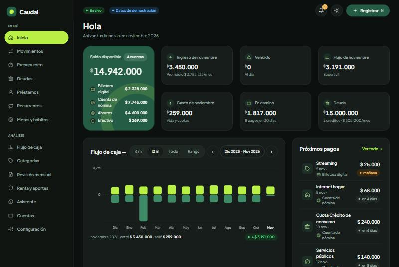
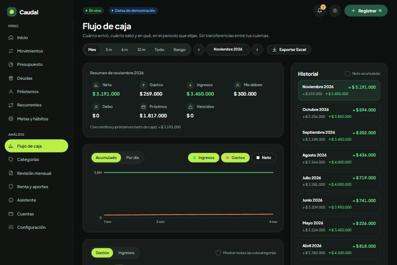
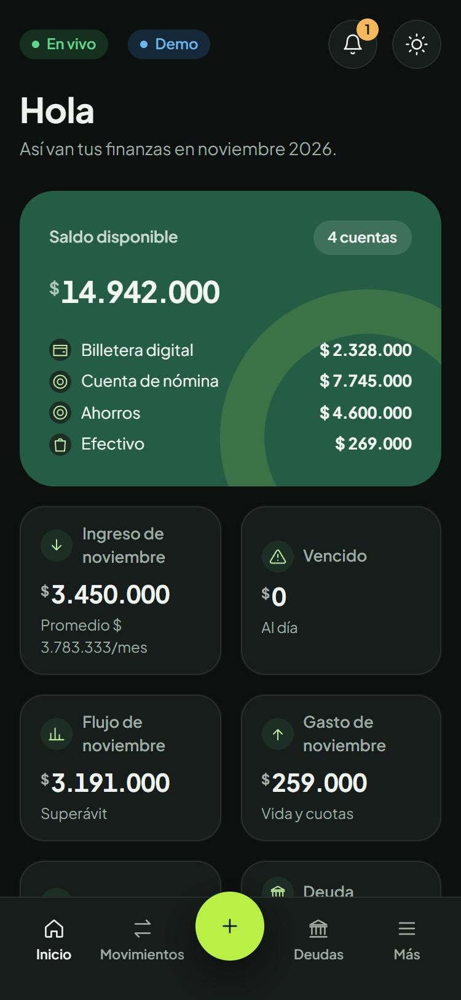

# Caudal · Finanzas

App local de finanzas personales para Colombia: tus datos viven en tu computador, en una base SQLite. Hecha para
quien tiene ingresos irregulares, créditos caros y quiere ver con claridad a dónde se va la plata.

> Las capturas y la demo usan datos **ficticios**: una persona inventada, generada con semilla fija.



| Flujo de caja | Celular |
|---|---|
|  |  |

## Qué hace

- **Captura rápida** de gastos, ingresos y transferencias, con sugerencia de categoría y actualización en vivo.
- **Inicio y flujo de caja**: saldo disponible, vencidos, próximos pagos, donas, mapa de calor y gráficos por periodo.
- **Deudas**: amortización con extractos, costo real frente a la tasa de usura y simulador avalancha o bola de nieve.
- **Presupuesto** por grupos de categorías, **recurrentes** con calendario y saldo proyectado, y **metas**.
- **Préstamos con personas**, con alerta de costo tipo gota a gota.
- **Renta y aportes**: termómetro en UVT, seguridad social e ingresos en USD con la TRM oficial.
- **Revisión mensual** con exportación a Excel, respaldos diarios y PWA instalable.
- **Asistente opcional** con la API de Claude: apagado hasta dar consentimiento; solo envía agregados.

## Probarla

Requisitos: [uv](https://docs.astral.sh/uv/) y Node 22 o superior.

```bash
git clone https://github.com/juandmurillo/finanzas-co.git
cd finanzas-co/app/backend
uv sync
uv run finanzas migrar
uv run finanzas sembrar
uv run finanzas servir        # API en http://127.0.0.1:8000
```

En otra terminal:

```bash
cd finanzas-co/app/frontend
npm install
npm run dev                   # http://localhost:5173
```

La primera vez eliges entre **empezar con tus datos** o **explorar con datos de ejemplo** (también con
`uv run finanzas demo`). En Windows, `iniciar.bat` levanta las dos partes después de instalar. Si tu red intercepta
TLS, usa `uv --system-certs` y `NODE_OPTIONS=--use-system-ca`.

## Arquitectura

FastAPI, SQLAlchemy 2, Alembic y SQLite en el backend; React 19, Vite, TypeScript, TanStack Query y Router en el
frontend. El dinero se guarda en centavos y las vistas se recalculan solas: cada cambio publica un evento de dominio y
la interfaz refresca por SSE solo lo afectado. Decisiones en [`docs/sistema/adr/`](docs/sistema/adr/) y esquema en
[`docs/sistema/03_MODELO_DATOS.sql`](docs/sistema/03_MODELO_DATOS.sql).

## Privacidad y seguridad

- La API solo escucha en `127.0.0.1` y rechaza escrituras de otros orígenes y hosts ajenos.
- La única llamada externa por defecto es la TRM en datos.gov.co. El asistente es opcional.
- `data/` y `.env` están fuera del repositorio. Las pruebas usan datos ficticios y CI corre gitleaks.
- Sin PIN por ahora: si la abres en tu red local, hazlo solo en una Wi-Fi de confianza.

No es asesoría financiera, tributaria ni legal; verifica los valores vigentes (UVT, usura, TRM).

## Calidad

```bash
cd app/backend && uv run pytest -q && uv run ruff check src tests && uv run mypy src
cd app/frontend && npm run typecheck && npm run lint && npm test
```

## Licencia

[MIT](LICENSE)
