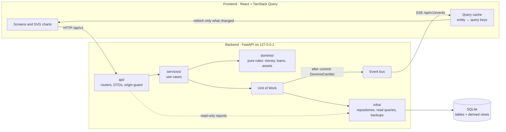

# Caudal · Finanzas

**English** · [Español](README.es.md)

Caudal is a local-first personal finance app for Colombia. It tracks accounts, budgets, debts, assets and taxes, and
recalculates everything live whenever you record a transaction. Your data stays on your machine, in a SQLite file.

> The screenshots and the demo use **fictional** data: an invented person, generated with a fixed seed.


https://github.com/user-attachments/assets/19c2f237-1216-46fd-a10f-8276519e8d2f


| Home charts | Cash flow charts |
|---|---|
|  |  |

| Debts | Assistant |
|---|---|
|  |   |


The interface is in Spanish; currency and rules are Colombian.

## Problem

Most finance apps assume a steady salary and a bank that syncs. That leaves out people with irregular income, expensive
consumer loans and cash or wallet payments. They need to know three things at any moment: how much is really available,
what is due next, and which debt to pay first. They also should not have to hand their financial history to a third
party to find out.

Caudal answers those questions from data you enter in seconds, and keeps all of it on your computer.

## Features

- **Quick capture** of expenses, income and transfers, with category suggestions and live updates.
- **Home and cash flow**: all-inclusive Income and Expenses, overdue and upcoming payments, donuts and a heat map.
- **Net worth**: accounts, money owed to you and assets, minus loans.
- **Assets and investments**: term deposits, funds, stocks, crypto, severance, real estate and vehicles, with value,
  gain and annualized return. Buying or selling an asset is not counted as expense or income.
- **Debts**: amortization from statements, real cost against the legal usury rate, and an avalanche or snowball
  simulator.
- **Budget** by category groups, **recurring payments** with a calendar and projected balance, and **goals**.
- **Personal loans** between people, with a warning when the cost looks like loan-shark lending.
- **Taxes and contributions**: filing thresholds in UVT including your assets, social security, and USD income at the
  official exchange rate (TRM).
- **Your data**: export to JSON, SQLite or Excel; import with a preview, restore backups, or delete everything.
- **Optional assistant** with your own key: Gemini, Groq, OpenRouter, Claude, or Ollama on your machine. It only
  proposes drafts; you review and confirm.
- **Installable PWA** and daily backups.

## Architecture



Dependencies point inward: `api → servicios → dominio`, and `infra` implements what the domain needs. A write goes
through one use case, inside one Unit of Work. Only after the commit succeeds, the Unit of Work publishes a
`DominioCambio` event naming the entities it touched. Every open client receives it over Server-Sent Events and
invalidates just the matching queries, so a transaction recorded on the phone updates the dashboard on the computer
without a reload.

## Key decisions

Full records are in [`docs/sistema/adr/`](docs/sistema/adr/) (in Spanish); the schema is in
[`docs/sistema/03_MODELO_DATOS.sql`](docs/sistema/03_MODELO_DATOS.sql).

- **Money is an integer number of cents.** Floats drift, and totals must match to the peso. Amounts are signed: positive
  comes in, negative goes out. Formatting happens only at the edge.
- **Derived values are never stored.** Balances and monthly totals come from SQL views and read queries, so they cannot
  fall out of sync with the transactions. A balance is corrected with an adjustment transaction, never edited.
- **Automatic recalculation by events, not polling.** Domain events after commit plus SSE were chosen over WebSockets
  (no need for two-way traffic), polling (wasteful, laggy) and SQL triggers (fragile, hard to test).
- **Local-first, single user.** The API listens only on `127.0.0.1` and rejects writes from other origins and hosts.
  The only external call by default is the exchange rate from datos.gov.co.
- **The assistant can read aggregates and propose, never write.** Its "write" tools produce a draft that opens the
  regular form. Keys live outside the database, so they are not included in exports or backups.
- **Income and Expenses mean everything.** One pair of totals is used on every screen, and Income − Expenses always
  equals operating cash flow.

## Stack

| Layer | Technology |
|---|---|
| Backend | Python 3.12+, FastAPI, SQLAlchemy 2, Alembic, SQLite |
| Frontend | React 19, TypeScript, Vite, TanStack Query and Router, hand-written SVG charts |
| Quality | pytest, Hypothesis, ruff, mypy, Vitest, Testing Library, ESLint |
| CI | GitHub Actions: backend, frontend and gitleaks |

## Run it

Requirements: [uv](https://docs.astral.sh/uv/) and Node 22 or later.

```bash
git clone https://github.com/juandmurillo/finanzas-co.git
cd finanzas-co/app/backend
uv sync
uv run finanzas migrar
uv run finanzas sembrar
uv run finanzas servir        # API at http://127.0.0.1:8000
```

In another terminal:

```bash
cd finanzas-co/app/frontend
npm install
npm run dev                   # http://localhost:5173
```

On first run you choose between **starting with your own data** and **exploring with sample data** (also available as
`uv run finanzas demo`). Once installed, `iniciar.bat` (Windows) or `./iniciar.sh` (macOS and Linux) start both parts.
If your network intercepts TLS, use `uv --system-certs` and `NODE_OPTIONS=--use-system-ca`.

## Tests

- **Backend: 140 tests** (pytest). They cover domain rules, API flows against a temporary database, migrations,
  import and export round trips, rejected malformed files, and the assistant with a fake HTTP transport.
- **Frontend: 37 tests** (Vitest). They include a smoke test that mounts all 15 routes with demo data.
- All tests use fictional data and never call a paid API.

```bash
cd app/backend && uv run pytest -q && uv run ruff check src tests && uv run mypy src
cd app/frontend && npm run typecheck && npm run lint && npm test
```

## Privacy and security

- The assistant is off until you accept, and switching providers asks again. With Ollama nothing leaves your machine.
- An uploaded file is validated in a temporary database before it touches your data, and a backup is taken before any
  replacement.
- `data/` and `.env` are outside the repository, and CI runs gitleaks.
- There is no PIN yet: if you open it on your local network, do so only on Wi-Fi you trust.

This is not financial, tax or legal advice. Check the current values (UVT, usury rate, exchange rate) before relying on
them.

## Limitations and roadmap

**Limitations today**

- Single user, no login or PIN, and no hosted version.
- Colombia only: currency, tax thresholds and loan rules. The interface is in Spanish only.
- No bank sync. Data comes from manual entry or a Cashew CSV export.
- On a phone it runs as a PWA served from your computer over the local network, not as a standalone app.
- The assistant's conversation is not saved between sessions, and free model tiers change without notice.
- Historical net worth is approximate before a loan was registered in the app.

**Roadmap**

- Standalone Android app (APK) that works without the computer.
- Generic CSV import with column mapping.
- PIN lock and encrypted backups.
- Saved assistant conversations.
- English interface.

## License

[MIT](LICENSE)
